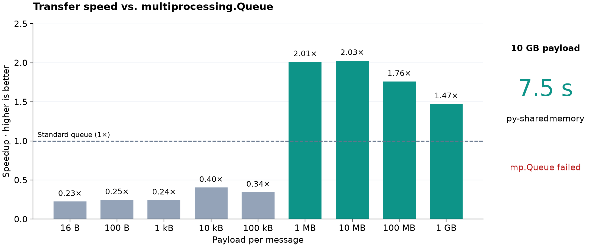

# py-sharedmemory

[](https://github.com/tobiaswuerth/python_shared_memory_queue/actions/workflows/ci.yml)
[](https://pypi.org/project/py-sharedmemory/)
[](https://pypi.org/project/py-sharedmemory/)
[](https://pypistats.org/packages/py-sharedmemory)
[](https://github.com/tobiaswuerth/python_shared_memory_queue/actions/workflows/ci.yml)
[](LICENSE)
[](https://github.com/astral-sh/ruff)
[](https://mypy-lang.org/)
[](https://github.com/pre-commit/pre-commit)

Send large Python objects between processes with less pipe I/O.

Originally built to reduce the heavy Windows pipe I/O and uneven throughput caused by
large `multiprocessing.Queue` transfers. Payloads travel through shared memory;
queues carry only small metadata, avoiding bulk transfers through the pipe.

Useful for **ML pipelines, reinforcement-learning actors and replay buffers,
scientific computing, and image/video processing**. Supports pickleable Python
objects with familiar `put/get` calls. No runtime dependencies, fully typed.
Python 3.11+ on Linux, macOS, and Windows.

```sh
pip install py-sharedmemory
```

## Measured performance



About **2× faster at 1–10 MB**; **10 GB transferred in 8.0 s**.
`mp.Queue` failed at 10 GB (Windows error 87). Small messages favor standard queues.

Core i9-14900K, 191.8 GiB RAM, Windows 11, Python 3.12.10, NumPy 2.5.3.
2026-10-08; contiguous float32 arrays; `spawn`; capacity 2; median of 5 runs,
excluding startup and warmup. Up to 1,000 messages or 512 MiB/run, at least one
message. GB = 10⁹ bytes. [Raw results](benchmarks/results/windows-numpy.json).
These measurements show transfer speed; I/O and stability depend on the workload.

## Usage

```python
import multiprocessing as mp
from memory import create_shared_memory_pair


def produce(sender):
    with sender:
        sender.put({"step": 42, "frames": bytearray(16_000_000)})
        sender.wait_for_all_ack()


if __name__ == "__main__":
    ctx = mp.get_context("spawn")
    sender, receiver = create_shared_memory_pair(capacity=2, ctx=ctx)
    worker = ctx.Process(target=produce, args=(sender,))
    worker.start()
    with receiver:
        batch = receiver.get(timeout=30)
    worker.join()
    sender.close()
```

One producing process per pair; multiple threads and consumers are supported.
Pass endpoints to workers before use. `put/get` support `block`, `timeout`, and
`*_nowait`. Capacity counts outstanding messages; 0/`None` is unbounded.

**Drain before producer close or exit:** `wait_for_all_ack(timeout=...)` returns
`False` on timeout. Close discards unread data. Within one process, drain before
closing either endpoint. Received data stays valid after cleanup; arrays preserve mutability.

A [complete example](examples/basic.py) includes error handling.

### API

| Call | Behavior |
| --- | --- |
| `create_shared_memory_pair(capacity=0, *, ctx=None)` | Returns `(sender, receiver)` built from one multiprocessing context. |
| `sender.put(obj, block=True, timeout=None)` / `put_nowait(obj)` | Copies `obj` into a new shared-memory block; raises `queue.Full`. |
| `sender.wait_for_all_ack(timeout=None)` | Waits until every block is received and freed; `False` on timeout. |
| `receiver.get(block=True, timeout=None)` / `get_nowait()` | Returns an independent local copy; raises `queue.Empty`. |
| `close()`, `closed`, `with endpoint:` | Both endpoints; using a closed endpoint raises `BrokenPipeError`. |

## Development

```sh
python -m pip install -e ".[dev]"
pre-commit install
python -m pytest --cov
pre-commit run --all-files
```

CI runs the tests on Linux, macOS, and Windows with Python 3.11–3.15 and requires
100% branch coverage on each. Pre-commit runs Ruff, mypy (strict), and file checks.

To release, update `__version__` in `memory/__init__.py` and the changelog, then
publish a GitHub release tagged `vX.Y.Z`. The release workflow uploads it to PyPI.

### Benchmark

```sh
python -m benchmarks.benchmark --sizes 16 100 1000 10000 100000 1000000 10000000 100000000 1000000000 10000000000 --repeats 5 --json benchmarks/results/windows-numpy.json
python -m benchmarks.plot benchmarks/results/windows-numpy.json benchmarks/results/windows-numpy.png
```

The full benchmark needs enough RAM for several payload copies.
